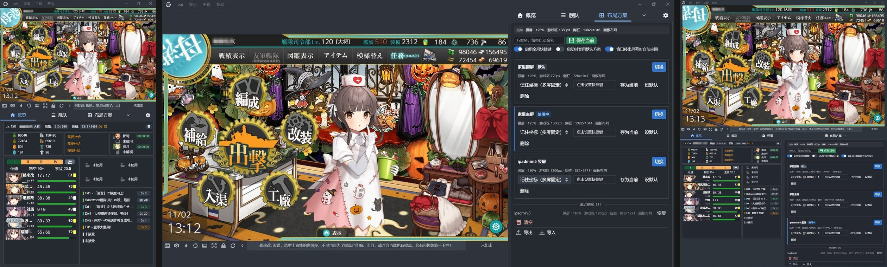
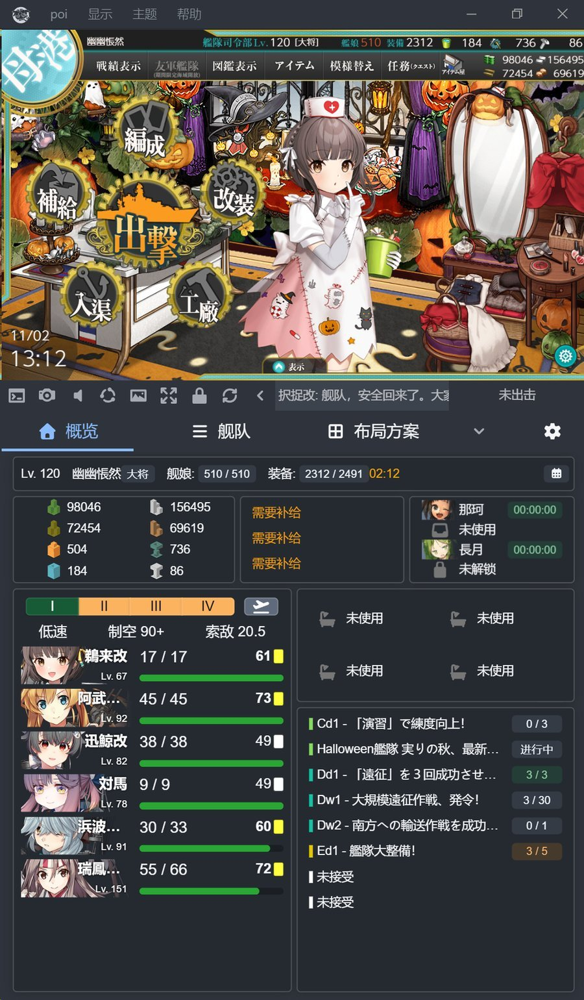
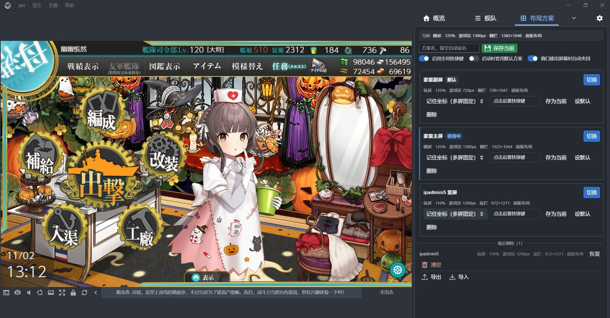

# 布局方案 · poi-plugin-layout-profiles

[](https://www.npmjs.com/package/poi-plugin-layout-profiles)
[](LICENSE)


给 [poi](https://github.com/poooi/poi) 加一层**布局预设**：把窗口位置尺寸、界面缩放、游戏区分辨率、
横竖布局、标签栏方向、概览面板摆放存成多套方案，一键或一个快捷键切换。

> Save complete poi layout presets — window bounds, UI zoom, game area resolution,
> orientation, tab area side and overview panel arrangement — and switch them with one
> click or a global hotkey.



*左：家里副屏（竖屏 125%）；中：家里主屏（横屏 1380px）；右：iPad mini 5 串流（竖屏 110%）*

---

## 它解决什么问题

poi 会记住最后的位置和缩放，但只有**一套**。这套记忆不分屏幕，也不管你是竖着还是横着。

```
家里副屏竖着挂远征  →  换到主屏横着打  →  出门用 iPad 串流
       每次都要重拖窗口、重设缩放、重调游戏区宽度
```

三种人最容易撞上这个：双屏副屏竖放的、远程串流（Moonlight / Parsec / ToDesk / RDP）的、
经常在全屏 / 小窗 / 半屏之间切换的。

装了之后：给每套方案绑一个全局快捷键，盲按就能切过去 —— 串流画面里也照样生效。

## 安装

poi 设置 → 插件 → 手动安装，填包名：

```
poi-plugin-layout-profiles
```

或者命令行：

```bash
cd %APPDATA%\poi\plugins
npm install poi-plugin-layout-profiles
```

装完重启 poi，标签栏出现「布局方案」。详细步骤见 [安装说明](docs/安装说明.md)。

## 使用

1. 把 poi 调成你想要的样子，点 **保存当前**（留空会自动命名，如「竖屏 125%」）。
2. 点 **切换** 立刻生效，不用重启。
3. 点 **点击设置快捷键**，按 `Ctrl+Alt+1` 这类组合 —— 全局热键，**串流画面里也能按**。
4. 卡片上的下拉框决定定位方式：

| 定位方式 | 说明 | 适合 |
| --- | --- | --- |
| 记住坐标 | 回到保存时的绝对坐标 | 双屏固定摆放 |
| 铺满所在屏 | 填满该显示器工作区 | 串流端分辨率变了也不跑偏 |
| 等比缩放 | 按当前屏幕比例缩放保存的尺寸 | 小窗 / 窗口化 |

其他按钮：**设默认**（启动时自动套用的那套）、**存为当前**（用当前状态覆盖该方案）、
**删除**（进回收站，保留最近 8 条）。覆盖与删除都要连点两下确认，触摸屏上不会误删。

### 截图

| 家里副屏 · 竖屏 125% | 家里主屏 · 横屏 1380px |
| --- | --- |
|  |  |

| iPad mini 5 串流 · 竖屏 110% |
| --- |
|  |

## 功能

- **多套方案一键切换**，即时生效，不用重启 poi
- **全局快捷键**，串流画面里可用
- **启动参数**：`poi.exe --layout-profile=串流横屏`，可以做多个桌面快捷方式
- **启动套用默认方案**
- **概览面板摆放一起存**：卡片坐标按 `lg/md/sm/xs/xxs` 五档断点整体保存，横竖切换不串味
- **窗口防丢**：串流端改分辨率后窗口跑到屏幕外，自动拉回主屏
- **二次确认 + 回收站**
- **导入导出** JSON，换机器直接搬
- 面板顶部实时显示当前状态，切完能立刻对照

## 存了些什么

| 方案里存的 | poi 的配置键 |
| --- | --- |
| 窗口位置、尺寸、最大化 | `poi.window` |
| 界面缩放 | `poi.appearance.zoom` |
| 游戏区固定分辨率 | `poi.webview.width` / `useFixedResolution` |
| 横排 / 竖排 | `poi.layout.mode` / `reverse` |
| 游戏区与面板比例 | `poi.webview.ratio.*` |
| 标签栏方向与网格 | `poi.tabarea.*` |
| 概览面板卡片摆放 | `poi.mainpanel.layout` |

## 为什么不用改 poi

poi 本体 `views/services/layout.js` 自己监听着 `config.set`，收到上面这些键就即时重排窗口与
游戏区；窗口几何又由 `lib/window.js` 自动写回 `poi.window`。插件只是一层预设管理器：
读快照、写回配置，不碰任何 poi 文件，也不依赖私有 API。

三个必须处理的细节（已在代码里）：

- `poi.appearance.zoom` 分支会在 1 秒后 `setContentSize` 一次，把刚设的窗口尺寸覆盖掉 →
  应用方案后按 0 / 250 / 1500ms 三次校正。
- `poi.layout.overlay=true` 会锁宽高比并禁止缩放 → 切换前先解除，开启放到几何校正之后。
- 连点两套方案时只有最后一次生效（token 作废前一次的三批延时调用）。

## 兼容性

- **poi 12** 实测（12.0.1）。
- **poi 10 / 11** 做了 `electron.remote` 与 `@electron/remote` 双代兼容，理论上能装，未实测。
- Windows 验证；macOS / Linux 未测试。

## 已知限制

- 串流软件自身若做了拉伸（Moonlight 的缩放选项），poi 这边设对了也会被二次处理，
  建议串流端用「原始分辨率 + 保持宽高比」。
- 同一断点宽度只能存一套面板坐标，两套方案落在同一档会互相覆盖该档布局。
- 全屏（F11）状态下尺寸由 Electron 接管，方案记录的是普通窗口边界。
- 面板内文案目前为中文，插件列表标题/描述提供 en-US、ja-JP 翻译。

## 数据

```
%APPDATA%\poi\layout-profiles\profiles.json
```

原子写入（先写 `.tmp` 再 rename），读到坏文件时备份成 `profiles.broken.json` 而不是清空。
支持导入/导出。

## 开发

源码用 `.es` 扩展名，由 poi 自带的 Babel 8 钩子转译，所以不能用 Node 直接跑。

本地调试的装法：

```
plugins/
├─ local/poi-plugin-layout-profiles/     ← 源码放这里
└─ node_modules/poi-plugin-layout-profiles → 指向上一行的 JUNCTION
```

再在 `plugins/package.json` 的依赖里加 `"poi-plugin-layout-profiles": "file:local/poi-plugin-layout-profiles"`。
改完源码重启 poi 即可生效，插件管理器里会显示「链接插件」标签（属正常）。

目录结构：

```
index.es             插件入口：reactClass 面板 + pluginDidLoad（热键、启动套用、窗口防丢）
lib/profiles.es      快照 / 存储 / 应用核心
lib/hotkeys.es       全局快捷键注册与按键转换
lib/remote.es        @electron/remote 与 electron.remote 双代兼容层
views/panel.es       poi 右侧标签页 UI（Blueprint 6）
i18n/                插件列表标题与描述的翻译
```

## License

MIT
